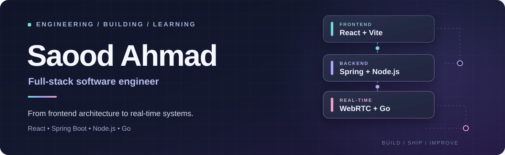

<!--
  GitHub profile README
  1) Create a public repository with the exact same name as your GitHub username.
  2) Upload README.md and the assets/ folder, preserving the directory structure.
  3) Replace YOUR_LINKEDIN_HANDLE and YOUR_EMAIL@example.com below.
  4) Link project names to repositories only when they are public.
-->

  

  
<strong>I like working on the whole problem, not just one layer of the stack.</strong>

  

    I build production web applications, backend services, and real-time systems. 
    My day-to-day work moves between shipping features, making architectural decisions, and figuring out why something broke in production.
  

  

    <a href="https://www.linkedin.com/in/YOUR_LINKEDIN_HANDLE/">LinkedIn</a>
    &nbsp;·&nbsp;
    <a href="mailto:YOUR_EMAIL@example.com">Email</a>
    &nbsp;·&nbsp;
    <a href="#selected-projects">Selected projects</a>
  

---

### What I do

<table>
  <tr>
    <td width="50%" valign="top">
      <h4>01 / Product engineering</h4>
      
Build features end to end across <b>React frontends</b> and <b>Spring Boot / Node.js backends</b>, from API design and integration to production debugging.

    </td>
    <td width="50%" valign="top">
      <h4>02 / Frontend architecture</h4>
      
Hands-on experience with <b>Vite and Module Federation in production</b>—architecture, micro-frontend integration, and troubleshooting.

    </td>
  </tr>
  <tr>
    <td width="50%" valign="top">
      <h4>03 / Real-time systems</h4>
      
Interested in the engineering behind low-latency communication: <b>WebSockets, WebRTC</b>, connection lifecycles, and observability.

    </td>
    <td width="50%" valign="top">
      <h4>04 / Developer tooling</h4>
      
Exploring tools and workflows that make engineering more reliable, including <b>AI-assisted development, isolated agent sessions, and code review</b>.

    </td>
  </tr>
</table>

### My toolkit

<table>
  <tr>
    <td width="180"><strong>Frontend</strong></td>
    <td> React · TypeScript · JavaScript · Vite · Module Federation</td>
  </tr>
  <tr>
    <td><strong>Backend</strong></td>
    <td> Spring Boot · Express.js · REST APIs · Go</td>
  </tr>
  <tr>
    <td><strong>Data &amp; cloud</strong></td>
    <td> PostgreSQL · MongoDB · Redis · AWS · Docker</td>
  </tr>
  <tr>
    <td><strong>Real-time</strong></td>
    <td> &nbsp;  &nbsp;  WebRTC · WebSockets · RTP</td>
  </tr>
</table>

### Selected projects

*Systems and tooling I am building or exploring outside day-to-day product engineering.*

<table>
  <tr>
    <td width="50%" valign="top">
      <h4>Digital Personal Diary</h4>
      
<em>In development · Personal productivity</em>

      
A private space to capture, organize, and revisit personal reflections through a digital diary.

      
<code>Personal productivity</code> <code>Web application</code>

    </td>
    <td width="50%" valign="top">
      <h4>Goal Grid</h4>
      
<em>In development · Goal tracking</em>

      
A focused space to set goals, break them into manageable steps, and track progress over time.

      
<code>Productivity</code> <code>Goal tracking</code> <code>Web application</code>

    </td>
  </tr>
</table>

### The kind of problems I enjoy

- **Across-the-stack debugging:** tracing issues through UI behavior, APIs, infrastructure, and the boundaries between them.
- **Architecture that holds up in production:** modularity, reliability, observability, and useful trade-offs over fashionable abstractions.
- **Learning by building:** using side projects to understand protocols, distributed systems, and engineering tools at a deeper level.

  
<strong>More about how I work</strong>

   
  I like owning features beyond the happy path—implementation, integration, deployment concerns, and the debugging that follows. I also use coding assistants as engineering tools, with a preference for explicit requirements, independent reviews, and verifying generated code rather than trusting it by default.

---

  Build things that work. Understand why they work. Keep making them better.

